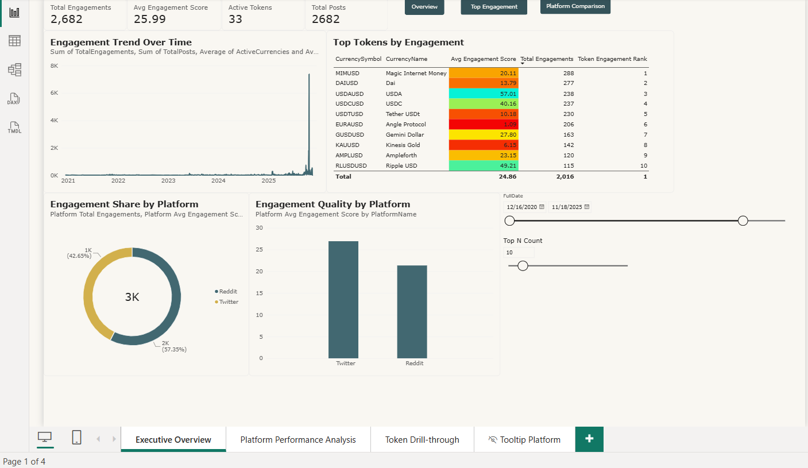
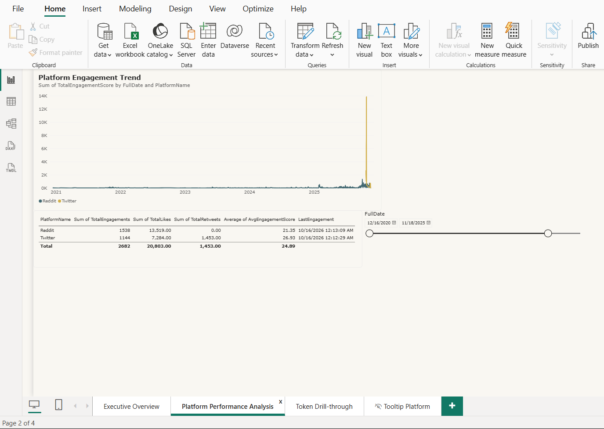
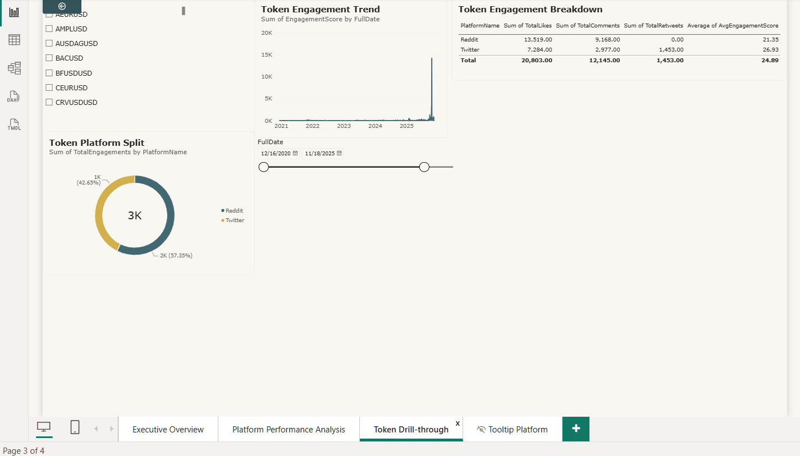
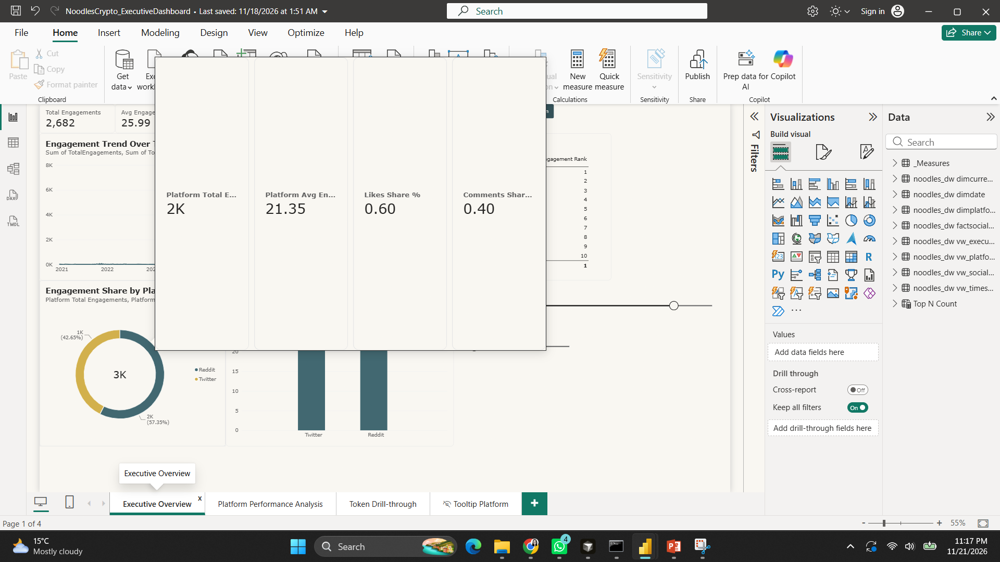
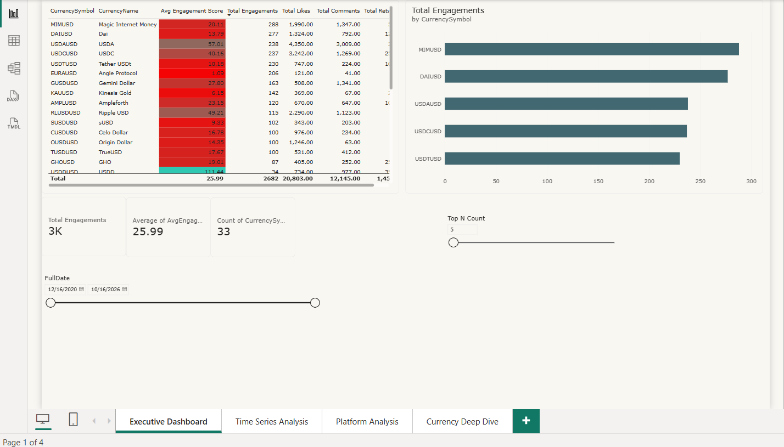
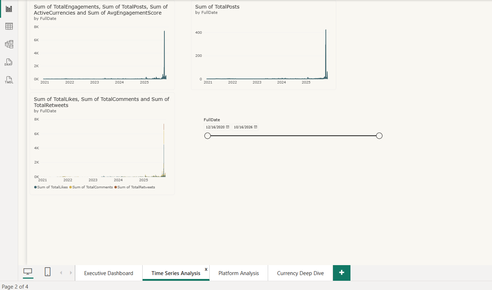
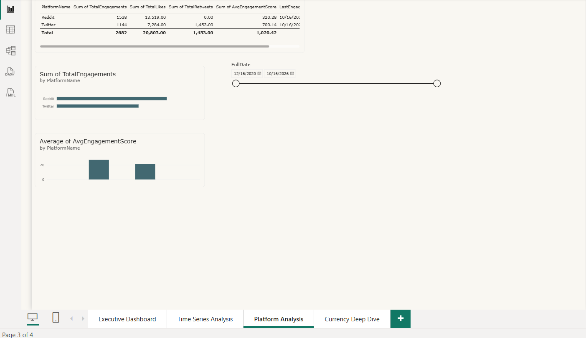
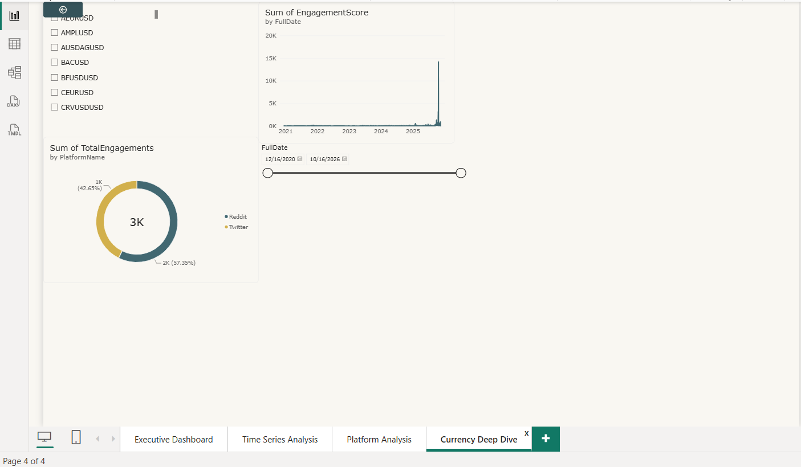

# Noodles Crypto Analytics Platform

An end-to-end data project that turns social media posts about crypto tokens into clear Power BI reports. Python cleans the data, a MySQL data warehouse stores it, and Power BI shows it.

Author: Mobassira Nasin, Data Analyst Trainee (Industry Connect), Hamilton, New Zealand

Demo video: [Watch the demo video on Canva](https://www.canva.com/design/DAHcD4QxPW8/rT94hc4rt5BGzqj2D4j1YQ/view?utm_content=DAHcD4QxPW8&utm_campaign=designshare&utm_medium=link&utm_source=recording_view)

## What this project does

Posts about crypto tokens sit in several raw files and come from two platforms, Twitter and Reddit. Reading them by hand takes too long. This project:

1. Reads the raw JSON and CSV files and cleans them with Python and pandas.
2. Loads the clean data into a MySQL database named `noodles_dw`, arranged as a star schema.
3. Builds summary tables and views for fast reporting.
4. Shows the results in two Power BI reports, so that a user can answer three questions in a few clicks: which token, which platform, and when?

## Key facts

| Item | Value |
|---|---|
| Social media posts | 2,682 (Twitter 1,144, Reddit 1,538) |
| Crypto tokens in the reports | 33 |
| Average engagement score | 25.99 |
| Twitter data | about 21 October to 18 November 2025 |
| Reddit data | 16 December 2020 to 16 November 2025 |
| Power BI reports | 2 (Top Performers, Executive Dashboard) |
| DAX measures in the Executive Dashboard | 28 |
| Relationships in the Power BI model | 8 |

## Architecture


| Layer | What it does |
|---|---|
| Source | JSON and CSV files of Twitter and Reddit posts |
| Staging | Python and pandas clean the data in memory (nothing is saved here) |
| Core | MySQL star schema in the database `noodles_dw` |
| Aggregation | Summary tables and views |
| Presentation | Power BI Desktop, Import mode |
| Orchestration | Two Jupyter notebooks control the process |

## Data model

The core is a star schema: one fact table in the middle and three dimension tables around it.

| Table | Rows | Purpose |
|---|---|---|
| `DimCurrency` | 78 | Token symbol, name and supply |
| `DimDate` | 2,131 | Year, quarter, month, week and day |
| `DimPlatform` | 2 | Twitter and Reddit |
| `FactSocialEngagement` | 2,682 | One row for each social media post |

Six summary tables are built on top of it:

| Table | Rows |
|---|---|
| `CurrencySocialEnrichment` | 75 |
| `CurrencySummary` | 33 |
| `CurrencySummary_Enriched` | 33 |
| `DailySocialSummary` | 619 |
| `FactSocialEngagementEnriched` | 2,682 |
| `SocialEngagementSummary` | 41 |

Four views feed Power BI: `vw_ExecutiveDashboard`, `vw_TimeSeries`, `vw_SocialAnalytics` and `vw_PlatformDaily`.

Full column details are in the [data dictionary](docs/data-dictionary.xlsx).

## Engagement score

Each post receives an engagement score. The two platforms have different data, so they use different formulas.

- Twitter: Likes x 1.0 + Retweets x 2.0 + Comments x 1.5 + Quotes x 1.2 + Impressions x 0.01
- Reddit: Likes x 1.0 + Comments x 3.0

Because the formulas differ, the scores of the two platforms are not exactly equal in meaning.

## Power BI reports

### Task 8: Executive Dashboard

Three visible pages and one hidden tooltip page. It has 28 DAX measures, three bookmark buttons, a drill-through page, a Top N slider and a date slicer.



| Platform Performance | Token Drill-through |
|---|---|
|  |  |

The hidden tooltip page appears as a small pop-up when the mouse stays over a platform in a chart:



### Task 7: Top Performers Report

Four pages: Executive Dashboard, Time Series Analysis, Platform Analysis and Currency Deep Dive. A Top N slider (5 to 50) changes the number of tokens shown, and a right-click on a token opens the Currency Deep Dive page.



| Time Series Analysis | Platform Analysis |
|---|---|
|  |  |



## Main findings

- Five tokens lead: MIMUSD (288 engagements), DAIUSD (277) and USDAUSD (238). The top five tokens hold 1,270 of the 2,682 posts (47%).
- Reddit gives 57% of the posts. Twitter posts have the higher average score: 26.93 against 21.35.
- In total there are 20,803 likes, 12,145 comments and 1,453 retweets. Only Twitter has retweets.
- Daily engagement rises sharply in late 2025, when the Twitter data begins. The Twitter data covers about one month and the Reddit data almost five years, so the peak partly reflects data coverage.
- These figures show social media attention only. They do not measure price.

## Data quality checks

- Row counts are checked in MySQL Workbench after each load.
- Checks look for facts that have no matching dimension row.
- Rows with an invalid date are removed.
- Bad records are saved in a rejects folder.

## Repository structure

```
noodles-crypto-analytics/
|-- README.md
|-- 05_data_warehouse_design.ipynb   Builds the star schema and loads the data
|-- 06_powerbi_prep.ipynb            Builds the summary tables and the four views
|-- .env.example                     Template for your database settings
|-- .gitignore                       Keeps the private .env file out of GitHub
|-- docs/
|   |-- architecture-diagram.png
|   |-- data-dictionary.xlsx
|   |-- technical-runbook.md
|   |-- user-guide.md
|   |-- demo-presentation.pptx
|   |-- final-checklist.md
|-- powerbi/
|   |-- NoodlesCrypto_TopPerformers.pbix
|   |-- NoodlesCrypto_ExecutiveDashboard.pbix
|-- images/                          Screenshots used in this README
```

## How to run it

Requirements: Python 3, MySQL Server (running on `localhost`, port 3306), Jupyter Notebook, JupyterLab or VS Code, and Power BI Desktop.

1. Install the Python libraries:
   `pip install pandas sqlalchemy pymysql python-dotenv matplotlib seaborn`
2. Copy `.env.example` and save the copy as `.env` in the same folder. Write your own MySQL user and password in it.
3. Put the source JSON and CSV files where notebook 05 reads them (the file paths are in its first cells).
4. Run notebook `05_data_warehouse_design.ipynb` from top to bottom. It creates the database `noodles_dw` and loads the star schema.
5. Run notebook `06_powerbi_prep.ipynb` from top to bottom. It builds the summary tables and the four views.
6. Open a `.pbix` file from the `powerbi` folder in Power BI Desktop, connect it to the `noodles_dw` database if asked, and click Refresh.

More detail is in the [technical runbook](docs/technical-runbook.md). For people who only want to read the reports, see the [user guide](docs/user-guide.md).

## Security

The database password is never written in the notebooks. It is read from a private `.env` file. The `.gitignore` file stops this file from being uploaded, so please never upload `.env`.

## Known limits

- The reports are not published to Power BI Service, so there is no scheduled refresh. To update the data, run the notebooks and click Refresh in Power BI Desktop.
- The pipeline does not write log files.
- The load does not check for duplicate Reddit post IDs.
- Slowly changing dimensions (SCD Type 2) are not implemented.
- The scores of Twitter and Reddit use different formulas.
- The project has no price data.

## Next steps

- Publish to Power BI Service with a scheduled refresh.
- Add log files and a duplicate check for Reddit posts.
- Add price data, to compare it with social media attention.

## Documents

- [Architecture diagram](docs/architecture-diagram.png)
- [Data dictionary](docs/data-dictionary.xlsx)
- [Technical runbook](docs/technical-runbook.md)
- [User guide](docs/user-guide.md)
- [Demo presentation](docs/demo-presentation.pptx)
- [Final checklist](docs/final-checklist.md)

## Author

Mobassira Nasin, Data Analyst Trainee, Hamilton, New Zealand
GitHub: [Mobassira18](https://github.com/Mobassira18)
